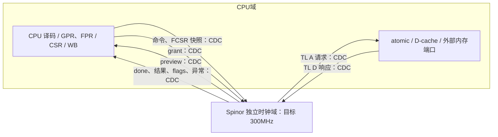

# CPU—Spinor 双时钟接入进展（2026-11-04）

CPU 与 VPU 保持独立时钟域，VPU 独立 300MHz 目标。当前新增异步事务 RTL 已完成编译和 FIR/SV 导出；双时钟功能与器件时序尚未验收。SoC 总线互连与 CMU 均未装配。冻结 r12 CPU 基线仍保留，misa.H/V 未宣告。

## CPU 侧准备程度

| 项目 | 状态 |
|---|---|
| V 指令/向量 CSR 路由、GPR/FPR 操作数、VS/FS 检查 | 已接入；同钟整核 GSIM 通过 |
| V 串行 WB、80 位身份、preview/grant/done、CPU FCSR 合并 | 已接入；同钟整核 GSIM 通过 |
| CPU/VPU 独立时钟边界 | RTL 已实现并编译/导出；独立边沿功能待验 |
| 向量虚拟内存、上下文切换与完整 V 合规 | 未完成 |
| H 指令权限译码 | 独立 GSIM 1827600 检查通过；尚未连入 CPU |
| H/VS CSR、虚拟化状态、trap/xRET、两阶段 MMU | 未完成 |

同钟定向程序在 L1/L12 下各退休 62 条、执行 17 条真实 VPU 命令，覆盖 f0、RUP/NX、向量存储与标量 cache 读回、LR/SC 保留清除和精确非法异常。该结果是指令语义证明，不是本次双时钟验收或向量性能评测。

## 数据流

CPU 先完成 VS/FS、操作数与旧工作排空检查，向量指令到达不可撤销 WB 后才发命令；CPU 保留 PC、token 和退休所有权，收到 preview 后授权，直到 done 才完成架构写回或异常。当前一条向量指令在途，IRQ 延迟到指令边界。Spinor 保存 VRF/向量 CSR，CPU 保存 FCSR。访存当前仍使用物理普通 RAM 和 CPU 既有 atomic/D-cache 路径；该路径不代表已接 SoC fabric 或完整向量 MMU。

| 完整事务 | 方向 | 位宽 | 当前容量 |
|---|---|---:|---:|
| 指令/操作数/AVL/token + frm/fflags 快照 | CPU → VPU | 312 | 1 |
| preview 结果 | VPU → CPU | 313 | 1 |
| grant token | CPU → VPU | 80 | 1 |
| done 结果/flags/异常 | VPU → CPU | 313 | 1 |
| TL A | VPU → CPU 内存服务 | 150 | 1 |
| TL D | CPU 内存服务 → VPU | 80 | 1 |

通道复用项目已有 `CdcMailbox`，ack 只在目标消费后返回。preview 每条只发送一次，CPU grant 接纳才消费其本地副本；done 被桥接收后由桥保存，CPU 仍持有 WB 至本地 done.fire。FCSR 随命令整体跨域，在 VPU 本地提供当条执行快照。没有逐位同步 token、操作数或 FCSR。

`commonColdReset` 必须覆盖 CPU、VPU、桥和外部内存事务 epoch，复位释放分别同步；当前不支持单域热复位、CMU 停钟/变频或上下文访问。`cpuTransportIdle/vpuTransportIdle` 只观察本地命令和六通道排空，不是全系统停钟许可。物理 CDC 仍需对同步器及 held-data 路径施加正确的局部约束并验收。

## 本轮验证与限制

- `SpinorHost.test.compile` 通过；真实双时钟顶层 FIR/SV 导出通过 firtool 电路检查，共 205 个 SV。
- 新顶层没有综合/布局布线结果，不继承 CPU r12 或历史 VPU 的器件时序结论。
- 使用当前已验证初始化修复的 GSIM 可执行文件，重跑既有独立边沿/复位 oracle：七种场景全部不匹配。
- held-low 连续评估 16 次，预期两个计数器均为 0，实际均为 16；5:3 比率预期 50/30，实际 300/300。运行后的 AsyncReset 预期归零，实际保留 32/32。
- 同一可执行文件不带 `--observe` 时按原契约返回 1，日志明确拒绝；观察模式退出 0 不代表能力或 CDC 通过。
- 双时钟完整 CPU GSIM 未启动，等待模拟器正确支持独立边沿及异步复位。没有替换仿真后端或修改 DUT 时钟以绕过限制。

原始证据：`build/i1-spinor-dual-clock-20261104-r1/assessment/receipt.json`，SHA256 `a35ed7c5c2e44a111540cc6be578f2b306a14db988bc194053c6429704cece96`。该 receipt 绑定源码快照、GSIM、命令、时钟探针正/负契约日志、FIR 及 Windows SV 哈希。上游 Spinor 锁定提交仍为 `e151f80e1da3a566d1a6ff5157052757fac0ddcb`，源码未修改。

状态：`ELABORATED_DUAL_CLOCK_RTL_GSIM_INDEPENDENT_CLOCK_RESET_UNSUPPORTED`。
